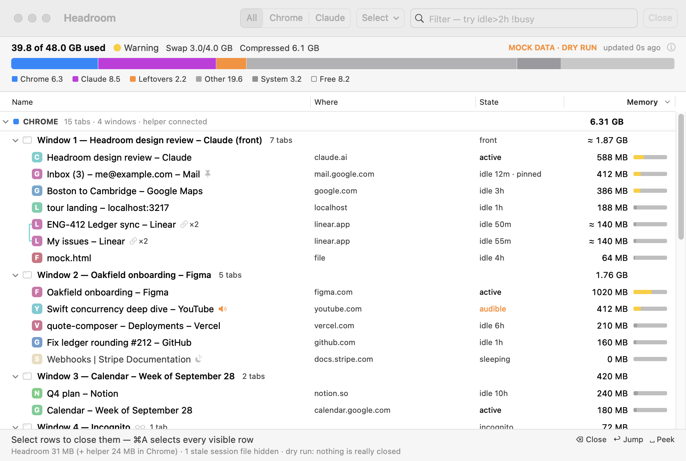

# Headroom

Headroom shows what is using your Mac's memory when you work with many Chrome tabs and Claude Code
sessions at once, and lets you close what you no longer need. It lists Chrome tabs, Claude Code
sessions and the dev servers that sessions left running after they ended, sorted by memory footprint.
You select rows and close them, and you can Undo: tabs reopen (with their history when the helper extension is
installed), and sessions resume in a new tmux window or Rex tab, where they ran.

It also shows what Docker costs, read-only: the memory of each running container, grouped by compose project,
what the Docker VM holds on your Mac, and the disk space of images, volumes and build cache.

It is a native macOS Dock app (Swift 6, AppKit, SwiftPM), a `headroom` CLI that agents can use too, and a small
Chrome helper extension for memory per tab. It is for people who keep many Claude Code sessions open, usually in
tmux or Rex, next to a busy Chrome.

**Status:** a personal tool, shared as it is. It runs on macOS on Apple Silicon only. You build it from source:
there are no binary releases, and the app is not notarized (it is signed locally, ad-hoc or with a self-signed
certificate that you make).



Design: [`docs/SPEC.md`](docs/SPEC.md), and the [design decisions](docs/DECISIONS.md) that override it.
Wire protocol: [`docs/protocol.md`](docs/protocol.md). CLI: [`docs/cli.md`](docs/cli.md).

## Requirements

- An Apple Silicon Mac with macOS 15 or later (`build.sh` builds for arm64 only).
- A Swift 6.4 toolchain or later (`swift-tools-version: 6.4` in `Package.swift`), from Xcode or the Command Line Tools.
  The build and the scripts also use `codesign`, `PlistBuddy`, `plutil`, `rsync` and `python3`, which macOS and the
  Command Line Tools provide.
- Google Chrome in `/Applications` for the Chrome section, and Claude Code (`~/.claude`) for the sessions.
- Optional:
  - tmux at `/opt/homebrew/bin/tmux` (the Homebrew path) for session locations, Jump and Undo of sessions;
  - Rex, for the same with sessions that run in Rex: the `rex` CLI at `~/.local/bin/rex`, or the one inside
    `/Applications/Rex.app` or `Rex Beta.app` (`HEADROOM_REX` sets another path). Built against Rex 0.1.0-preview.20 (API revision 16);
    see [tmux and Rex](#tmux-and-rex);
  - Ghostty 1.3 or later, so that Jump brings the right terminal window forward (sessions in tmux);
  - AeroSpace (`install.sh` can add a rule so the Headroom window floats);
  - `openssl` for `scripts/make-signing-cert.sh` (the system LibreSSL works);
  - Bun and Chrome for Testing, only for the end-to-end tests in `Tests/e2e-chrome/`.

## First run

Do these steps once, in this order. `install.sh` asks before each step. `make-signing-cert.sh` and `build.sh`
run without asking. Every script prints what it did.

1. **Make the signing certificate** (optional, but recommended):

   ```sh
   scripts/make-signing-cert.sh
   ```

   This puts a self-signed "Headroom Local Signing" identity in your login keychain. With it, macOS
   remembers the Chrome and Ghostty Automation grants across rebuilds. Without it, `build.sh` signs
   ad-hoc and macOS asks again after every rebuild. The first build after this may show a keychain
   prompt for `codesign`: choose **Always Allow**.

2. **Build:**

   ```sh
   scripts/build.sh            # -> build/Headroom.app (release, arm64, signed)
   scripts/build.sh --mock     # also opens it with fake data and HEADROOM_DRY_RUN=1, to try it safely
   ```

3. **Install:**

   ```sh
   scripts/install.sh          # add --dock to also pin it in the Dock (the Dock is backed up first)
   ```

   | What | Where |
   |---|---|
   | The app | `~/Applications/Headroom.app` |
   | The CLI | `~/bin/headroom` → `Headroom.app/Contents/Helpers/headroom` |
   | Extension folder for Load unpacked | `~/Library/Application Support/Headroom/ChromeExtension/` |
   | Chrome bridge file | `~/Library/Application Support/Google/Chrome/NativeMessagingHosts/dev.adder.headroom.json` |
   | Dock backup (`--dock` only) | `~/Library/Application Support/Headroom/dock-backup-install-<time>.plist` |
   | Floating-window rule (only if you use AeroSpace) | appended to your `aerospace.toml`, with a backup next to it |

   Without `--dock`: open Headroom, then right-click its Dock icon ▸ Options ▸ Keep in Dock.

4. **Load the Chrome helper extension** (for memory per tab; once per Chrome profile):
   1. Open `chrome://extensions` and turn on **Developer mode**.
   2. Click **Load unpacked**, press ⌘⇧G and paste
      `~/Library/Application Support/Headroom/ChromeExtension`.
   3. Check that the id is the one `install.sh` printed (it comes from the fixed key in
      `Extension/manifest.json`). Chrome may show a notice about developer-mode extensions; that is expected.

   Headroom's "Set up…" sheet walks through the same steps and ticks them off. The helper cannot read
   page content, cookies or history: it has no host permissions and no content scripts.

5. **Grant Automation** (optional; for the tab list without the extension, and for jumping to the exact
   Ghostty window). Headroom never asks on its own:
   - **Chrome:** click **Allow…** on the Chrome card in Headroom.
   - **Ghostty:** macOS asks the first time you Jump to a Claude session in tmux.
   - To change either later: System Settings ▸ Privacy & Security ▸ Automation ▸ Headroom.

   Rex needs no Automation. To let Jump switch Rex to another session, turn on **Remote Control** in Rex (it is off
   by default).

After an update, run `scripts/build.sh && scripts/install.sh` again. Then click the reload icon on the
helper in `chrome://extensions` if the extension changed.

### What works without any of this

The Claude sessions, Leftovers, the memory strip and the Chrome section totals work with no setup and no
prompts. Per-tab memory needs the extension. The tab list and closing tabs need the extension or Automation ▸ Chrome.

## Keys

| Keys | Action |
|---|---|
| Click, ⌘-click, ⇧-click | Select, toggle, select a range (as in Finder) |
| ↑ ↓, ⇧↑ ⇧↓, ⌥↑ ⌥↓ | Move, extend, first/last row |
| → ←, ⌥→ | Expand or collapse a group; ⌥→ expands all levels |
| ⌘A / Esc | Select all visible rows / deselect |
| ⌫ or ⌘⌫ | Close the selection. It closes at once with an Undo toast. A sheet appears only when a row needs a check (busy, leftover, pinned, last window…) |
| ⌥⌫ | Close Now: skip the sheet, except for busy sessions, leftovers and unregistered claude |
| ⌃⌫ | Sleep the tab (discard it; extension only) |
| ⌘Z / ⇧⌘Z | Undo / redo the last close batch |
| ⌘Y | Recently Closed (today's batches, with Restore) |
| ↩ or double-click | Jump to the tab, the tmux pane or the Rex pane |
| Space | Peek (details; follows ↑/↓) |
| ⌘C | Copy URLs, resume commands (`cd '<cwd>' && claude --resume <id>`) or a leftover's command |
| ⌘⇧R / ⌘O | Reveal the cwd in Finder / open the transcript |
| ⌘F | Filter, for example `idle>2h !busy`, `>500mb`, `site:github.com`, `tmux:hub`, `rex:foundry`, `is:leftover` |
| ⌘R | Refresh now |
| ⌘1 / ⌘2 / ⌘3 | Show All / Chrome / Claude |
| ⌘W | Close Headroom's window (this quits Headroom; it never closes an item) |

A fast sweep: ⌘F `idle>2h !busy`, then ⌘A, then ⌫. Leftovers cannot be undone, so they always ask first.
Locked rows (Chrome itself, the session that launched Headroom) can be selected for Peek but are never closed.

## tmux and Rex

Headroom shows where each Claude Code session runs, and Jump and Undo go back there. It understands two terminal
multiplexers: tmux and Rex. tmux works as it always did.

- **Where:** `hub:3.1` (tmux `session:window.pane`) or `rex foundry:2.1` (Rex `session:tab.pane`, both numbers
  from 1). Headroom decides from the process tree, and the nearest multiplexer wins: a claude in tmux inside a Rex
  pane is in tmux. For Rex it reads the claude's own `REX_BLOCK` and `REX_SESSION`, and runs `rex ls` and
  `rex session inspect` only when a claude runs in Rex. It never starts a Rex server.
- **Visible:** a Rex pane is visible when Rex.app is attached to its session, the pane's tab is the session's
  active tab, and the pane is drawn (not minimized, and not hidden behind a zoomed pane). Rex cannot tell Headroom
  which session the app is showing, so every such pane counts. A pane Headroom cannot place (shown as `foundry:?`)
  also counts as visible, and so does a pane whose active tab or attached apps Rex reports in a way Headroom does
  not understand. So in Rex, more sessions ask before closing than in tmux, never fewer.
- **Jump:** Rex focuses the pane, Rex.app comes forward, and Headroom asks Rex.app on this Mac to show the session
  (never Rex on another device). That last step needs **Remote Control** turned on in Rex. When it does not work, a
  toast tells you which session to open and why (for example, Remote Control is off, or Rex.app is not connected yet).
- **Undo:** a new tab in the same Rex session (or a new session, if it is gone) runs `claude --resume <id>`. A new
  session is shown as in Jump; if Rex.app cannot be asked to show it, the Undo toast (and `headroom undo`) says
  "Resumed in the new Rex session “<name>”; open it in Rex." and why. If Rex is not running, Undo fails and the
  session stays in Recently Closed: open Rex, then Undo again.

Limits of the Rex support:

- It was built against Rex 0.1.0-preview.20 (API revision 16). Only the read-only Rex calls were run against a real
  Rex server; Jump and Undo were tested against a fake `rex`. A newer Rex may report its layout differently:
  `headroom selftest claude` checks that every claude in Rex is placed, and prints the Rex version.
- With several Rex.app windows, or a tab torn off into its own window, a pane that is on screen can show as not
  visible. This is not checked yet.
- Headroom reads only your own Rex server. A claude in a pane of another Rex server (for example a private test
  server) shows as `<session>:?` and is protected like a visible pane.
- Headroom does not read Rex pane titles. A session in tmux without a user-set name or an AI title is titled from
  its tmux pane title; a session in Rex in that case falls back to its other names, or to its project folder.

## Docker

When a Docker engine runs on your Mac (colima, Docker Desktop, OrbStack, Rancher Desktop), the list ends with a
`DOCKER` section and the memory strip gets a `Docker` segment. No setup is needed: Headroom reads the engine's
local socket.

- The section's number is what the Docker VM holds on your Mac. The rows show memory inside the VM, per container,
  with compose projects as groups. The VM often holds more than its containers use, because it does not always
  give memory back to macOS when a container stops; restarting the VM (for example `colima restart`) does.
- The last line is disk use (images, build cache, volumes, container layers) and how much `docker system prune`
  and `docker volume prune` could free. It is read in the background, so it can be a few minutes old.
- It is read-only. You cannot select these rows, and Headroom never stops a container or prunes anything.
- `is:container` in the filter shows only this section. In the CLI: `headroom list --kind docker`.
- When Headroom cannot tell which process is the Docker VM, the number is the sum of the containers instead.

## Screenshots

All screenshots show the built-in mock data (`--mock`), in dry run.

- [Filter sweep](docs/screenshots/filter-sweep.png): `idle>2h !busy is:session` in the filter, ready for ⌘A and ⌫.
- [Selection](docs/screenshots/claude-selection.png): three idle sessions selected; the strip shows what the selection frees.
- [Confirm sheet](docs/screenshots/confirm-sheet.png): a close that needs a check (a busy session, background
  processes and a leftover).
- [Undo toast](docs/screenshots/undo-toast.png): the toast after a close, with Undo (⌘Z).
- [Recently Closed](docs/screenshots/recently-closed.png): ⌘Y, to restore a whole batch or single items.
- [Peek](docs/screenshots/peek-session.png): Space on a session shows its folder, memory, tmux pane and resume command.
- [First run](docs/screenshots/first-run-card.png): the Chrome card before the helper extension is set up.

## CLI

`~/bin/headroom` uses the same data and safety checks as the app. Closes from the CLI go to the same
log and Recently Closed list, so the app can undo them.

```sh
headroom list                       # table of tabs, sessions and leftovers, biggest first
headroom list --json --kind sessions
headroom list --kind docker         # containers by compose project, the VM's memory, disk use (--disk reads disk again)
headroom suggest                    # rule-based close candidates + a ready-to-run close line
headroom suggest --ask              # also asks `claude -p` for a second opinion (never closes anything)
headroom close <id> <id> …          # shows the plan, then asks y/N; --yes skips the question
headroom close <id> --dry-run
headroom undo --last                # reopen the tab / resume the session
```

Ids look like `tab:812:1101007`, `session:41000:1790694600` or `leftover:7164:1790613600`. Items that
would need the confirm sheet in the app are refused unless you add `--force-confirm`. Busy sessions also need
`--include-busy`. Locked items are always refused. Exit codes: `0` ok, `1` error, `2` needs confirmation or refused. `HEADROOM_DRY_RUN=1`
makes every close a no-op that is logged only. `--mock` uses built-in fake data. Details: [`docs/cli.md`](docs/cli.md).

## Privacy

Headroom makes no network requests. The app, the CLI and the native-messaging host have no networking code.
Docker is read through the engine's local unix socket, with read-only requests.
The helper extension has no host permissions and no content scripts, and it passes on a tab's favicon only when
Chrome already has it as a small `data:` URL.

The one exception is opt-in: `headroom suggest --ask` pipes the snapshot (tab titles and URLs, session folders,
last prompts and git state) to `claude -p`, so it goes to Anthropic like any other Claude Code prompt.
Incognito tab titles are replaced with `(incognito tab)`, and incognito URLs are left out.

What Headroom reads, all on your Mac:

- **Processes:** memory footprint, parent, process group, path and arguments of each process. From each process's
  environment it keeps only `CLAUDE_*` keys (minus any key that looks like a credential), `TMUX`, `TMUX_PANE`,
  `REX_SESSION` and `REX_BLOCK` (Rex session and pane ids).
- **Claude Code:** `~/.claude/sessions/*.json`, and the end of each session's transcript in `~/.claude/projects/`
  (title, last prompt, last assistant line, away summary). It never writes there.
- **tmux, Rex and git:** the tmux pane and client lists; when a Claude session runs in Rex, the Rex session list and
  each Rex session's tabs, panes and attached apps (`rex ls`, `rex session inspect`); and each session folder's
  `.git/HEAD`. Headroom never starts a Rex server. Peek on a session shows the last 15 lines of its tmux pane or the
  last 60 lines of its Rex pane, and Peek on a leftover runs `lsof` for its listening ports. `git status` runs only
  for `suggest --ask`.
- **Chrome:** tab titles, URLs, windows and the renderer process of each frame, through the helper extension, or
  titles and URLs through AppleScript if you allowed Automation. Never page content, cookies or history.

What Headroom writes, in `~/Library/Application Support/Headroom/`:

- `actions.jsonl`: one line per signal, close, discard or restore (also in dry run). This is the audit log.
- `closed.jsonl` and `restored.jsonl`: Recently Closed, for Undo. Pruned after 7 days. Incognito URLs are never written.
- `chrome-restore.json`: Chrome's session ids for closed tabs, so Undo can restore their history.
- `run/app.sock`: the socket that the native-messaging host connects to.

`install.sh` also writes the files listed under [First run](#first-run). The app keeps its columns, list options
and expanded rows in its macOS preferences.

## Uninstall

```sh
scripts/uninstall.sh                  # removes the app, CLI link, bridge file, Dock tile, AeroSpace rule
scripts/uninstall.sh --restore-dock   # puts back the whole Dock from the newest install backup instead
scripts/uninstall.sh --purge          # also deletes ~/Library/Application Support/Headroom (logs, backups)
```

It removes only things that are clearly Headroom's. Remove the helper yourself at `chrome://extensions`.
To forget the signing identity: open Keychain Access, find "Headroom Local Signing" and delete it.

## Troubleshooting

- **Chrome says "Specified native messaging host not found"**: run `scripts/install.sh` again, or just
  open Headroom: at launch it repairs an existing bridge file whose path or id is wrong (not in dry run).
  A missing bridge file is written by `scripts/install.sh`.
- **macOS asks for Automation after every build**: the build is ad-hoc signed. Run `scripts/make-signing-cert.sh`.
- **Two "Headroom Local Signing" identities**: `build.sh` uses the first one. Pin one with
  `SIGN_ID=<sha1> scripts/build.sh` (`security find-identity -p codesigning` lists them).
- **Headroom's own cost**: the footer shows the app, the host and the helper extension's memory.
- **Jump to a session in tmux brings up the wrong Ghostty window**: the toast says why. Usually Headroom is not
  allowed to control Ghostty: turn it on in System Settings ▸ Privacy & Security ▸ Automation ▸ Headroom. macOS asks
  once, at the first Jump; if you never saw the prompt, run `tccutil reset AppleEvents dev.adder.headroom` and Jump
  again (this also resets the Chrome permission). Headroom finds the window by the tmux client's tty, so window titles
  do not matter.
- **Jump into Rex brings Rex forward but shows another session**: the toast names the Rex session to open and says
  why. Usually Remote Control is off: turn it on in Rex. If it says Rex.app is not connected, Jump again once Rex.app
  has a window open.
- **Undo says "Rex is not running"**: open Rex, then Undo again. Headroom never starts a Rex server itself.
- **A session in Rex shows as `<session>:?` or `not in tmux or Rex`**: run `headroom selftest claude`. Its `rex`
  check lists the claudes it could not place, and those without `REX_BLOCK`/`REX_SESSION` in their environment.

---

## Development

### Layout

| Target (module) | Kind | Depends on |
|---|---|---|
| `HeadroomContracts` | library (shared types) | Foundation |
| `HeadroomCore` | library | Contracts |
| `HeadroomClaude` | library | Contracts, Core |
| `HeadroomChrome` | library | Contracts, Core |
| `HeadroomDocker` | library | Contracts, Core |
| `HeadroomActions` | library | Contracts, Core, Claude, Chrome, Docker |
| `HeadroomApp` (product `HeadroomApp`, bundled as `Headroom`) | executable | Contracts, Core, Chrome, Actions |
| `HeadroomCLI` (product `headroom`) | executable | Contracts, Core, Actions |
| `headroom-host` | executable | Contracts |
| `Extension/` | MV3 extension | – |
| `scripts/` | build, install, signing | – |

Test fixtures: `Tests/Fixtures/` (a `ps` capture in `ps.txt` and `psargs.txt` with `ownership-overlay.json`,
captured tmux output, and hand-written `rex … --json` output in `rex-*.json`), used by the Core and Claude tests.

### Scripts

| Script | What it does |
|---|---|
| `scripts/build.sh [--run\|--mock]` | Release build, then assembles and signs `build/Headroom.app`. Env: `SIGN_ID`, `SIGN_KEYCHAIN`, `SCRATCH` (SwiftPM scratch path), `OUT`, `BIN_DIR` (package prebuilt binaries) |
| `scripts/mkicon.swift <out.icns>` | Draws the gauge icon; `--png <px> <out.png>` for one PNG (for example extension icons) |
| `scripts/extension-id.sh [manifest]` | Prints the extension id from the manifest's `key` |
| `scripts/make-signing-cert.sh [--keychain <kc>]` | Creates the signing identity (run it once; `--keychain <kc>` writes to a scratch keychain instead of the login keychain) |
| `scripts/install.sh [--dock] [--yes] [--app <path>]` | Installs for `$HOME`; see First run |
| `scripts/uninstall.sh [--restore-dock] [--purge] [--yes]` | Reverses install.sh |
| `scripts/tcc-probe.sh [--build\|--reset]` | SPEC §10 check, run by hand: builds and opens a tiny app whose `osascript` child asks for Automation ▸ Ghostty, to confirm the prompt names the app |
| `scripts/dock-tile.py`, `scripts/_common.sh` | Helpers for install/uninstall (Dock plist edits work on files only) |

Bundle layout: `Contents/MacOS/Headroom`, `Contents/Helpers/{headroom-host,headroom}`,
`Contents/Resources/{AppIcon.icns,ChromeExtension/}`, and `Info.plist` with `HeadroomExtensionID`.
The helpers are signed first (identifiers `dev.adder.headroom.host` and `.cli`), then the app. There is no hardened runtime and no sandbox.

### Build and test

```sh
swift build
HEADROOM_DRY_RUN=1 swift test
HEADROOM_DRY_RUN=1 swift test --filter <Target>Tests     # one target, for example HeadroomCoreTests
```

To run several builds at once (for example from parallel agents), give each one its own scratch path, such as
`--scratch-path .build/<name>`, to avoid SwiftPM lock contention.

Try it without touching anything real:

```sh
HEADROOM_DRY_RUN=1 .build/debug/headroom --mock list
HEADROOM_MOCK=1 HEADROOM_DRY_RUN=1 .build/debug/HeadroomApp --dump-json
scripts/build.sh --mock   # assembles build/Headroom.app and opens it with fake data
```

Test the install scripts only in a scratch home, with a copy of the Dock plist:

```sh
defaults export com.apple.dock /tmp/dock-copy.plist          # read-only copy
HOME=/tmp/hr-home DOCK_PLIST=/tmp/dock-copy.plist scripts/install.sh --yes --dock
HOME=/tmp/hr-home DOCK_PLIST=/tmp/dock-copy.plist scripts/uninstall.sh --yes
```

With a scratch `HOME`, the scripts write only inside it. They refuse to edit the live Dock unless
`HOME` is your real home, and they never run `killall Dock` when `DOCK_PLIST` is set.

### Safety

`HEADROOM_DRY_RUN=1` in every dev and test run. Test signalling only on dummies you spawned; test Chrome
behaviour only in Chrome for Testing with a scratch profile; test tmux only with `HEADROOM_TMUX_SOCKET=headroom-test`.
Test Rex only with `RexStub` (a fake `rex` that never reaches a server; `swift test` uses it by default), or with
`HEADROOM_REX_LIVE_TEST=1`, which starts and stops its own private Rex server. That test leaves empty `start.lock`
files in `~/Library/Application Support/rex/servers` and prints them. Never point `HEADROOM_REX_SERVER` at your own
Rex server's socket. See SPEC §11 and `Sources/HeadroomContracts/Env.swift` for all test seams.

## License

MIT. See [`LICENSE`](LICENSE).
